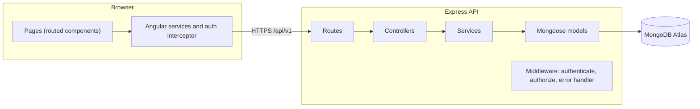
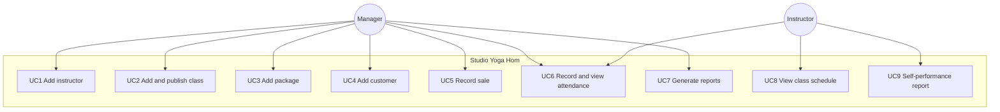
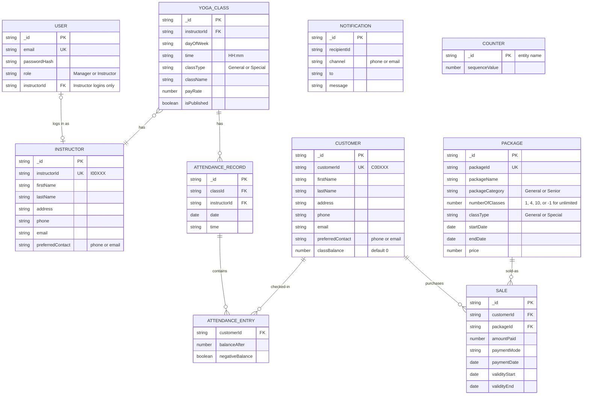
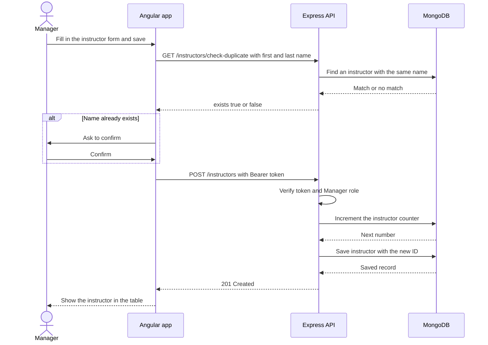
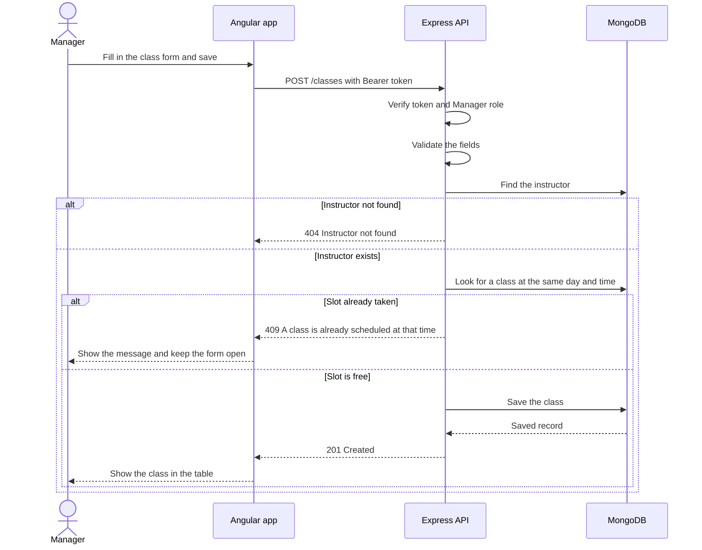
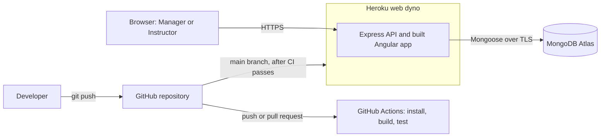
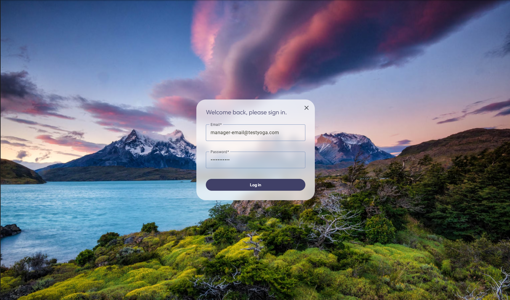
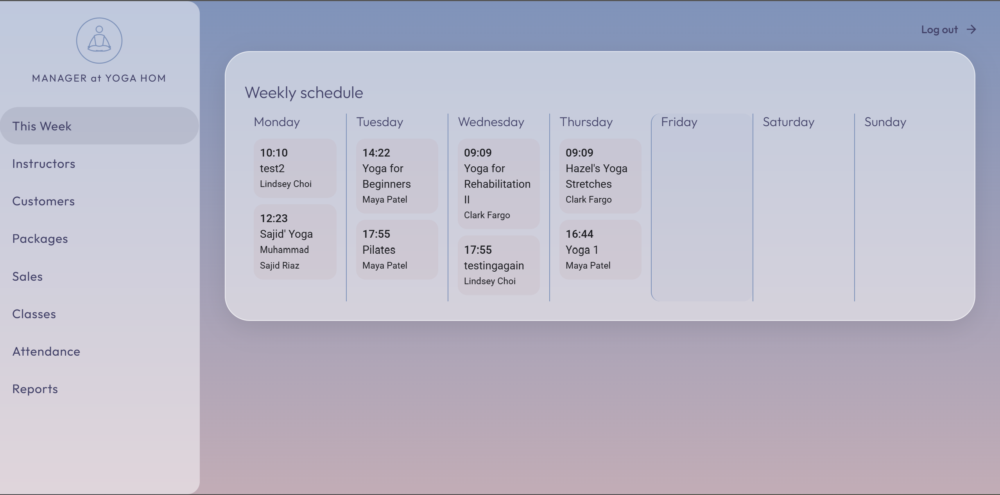
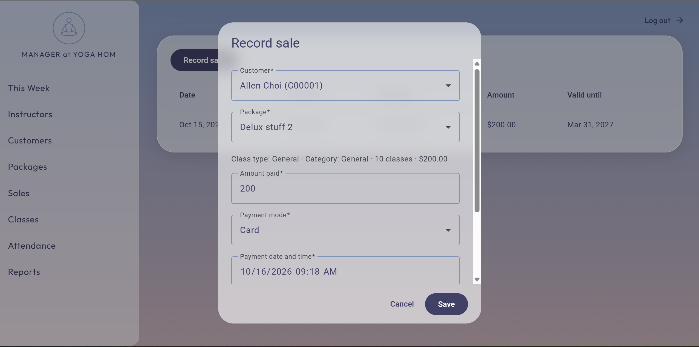
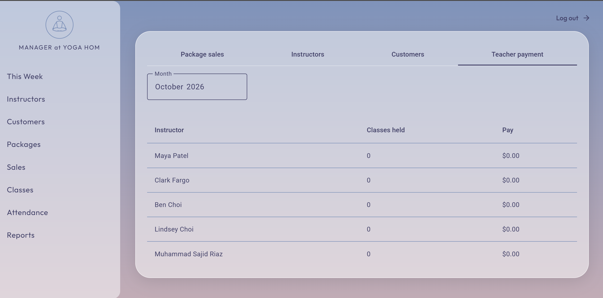

# Project Report (Part 2) Studio Yoga 'Hom

Course: ACS-5423-999, Fall 2026

Author: Lindsey Choi

Live application: https://lindsey-c-yoga-project-21bd18fc0ab6.herokuapp.com/

Source code: https://github.com/lindseychoi/yoga-hom-project-lchoi

## 1. Introduction

Yoga Hom Studio is a small yoga studio in Pittsburgh, PA. It keeps its records on paper: instructors, customers, the class schedule, package sales, and attendance. Paper records are slow to search and easy to get wrong, and they can't produce the reports the studio needs, such as package sales, instructor check-ins, and monthly teacher pay.

Studio Yoga 'Hom is a web application that replaces those records. It has two kinds of users. A Manager runs the studio's data: instructors, classes, packages, customers, sales, and reports. An Instructor records attendance for their own classes. Customers are records the Manager keeps. They never log in.

Part 2 calls for the complete application, deployed on the cloud with a CI/CD pipeline, plus an updated report. All seven use cases from the requirements are built, along with the other actions in the use-case diagram: publishing the schedule, viewing attendance, an instructor's own schedule, and their self-performance report. The app runs on Heroku with a MongoDB Atlas database. GitHub Actions builds and tests every change, and Heroku deploys `main` automatically.

### 1.1 Technology stack

| Layer | Technology |
|-------|-----------|
| Frontend | Angular 21 (standalone components), Angular Material, TypeScript |
| Backend | Node.js, Express 5, TypeScript, Mongoose 9 |
| Database | MongoDB Atlas (free tier) |
| Authentication | JSON Web Tokens, with passwords hashed using bcrypt |
| CI/CD | GitHub Actions for build and test, Heroku automatic deploys |
| Hosting | One Heroku dyno. Express serves the API and the built Angular app |

The assignment specifies the MERN stack. I used Angular instead of React, with the instructor's approval by email on Sunday, September 6, 2026.

## 2. Requirements and use cases

### 2.1 Use case summary

| ID | Use case | Actor | Status |
|----|----------|-------|--------|
| UC1 | Add an instructor | Manager | Implemented |
| UC2 | Add a class and publish the schedule | Manager | Implemented |
| UC3 | Add a package | Manager | Implemented |
| UC4 | Add a customer | Manager | Implemented |
| UC5 | Record a sale | Manager | Implemented |
| UC6 | Record and view class attendance | Instructor, Manager | Implemented |
| UC7 | Generate studio reports | Manager | Implemented |
| UC8 | View class schedule | Instructor | Implemented |
| UC9 | Self-performance report | Instructor | Implemented |

The Manager can also edit and delete instructors, classes, packages, and customers.

### 2.2 UC1: Add an instructor

The Manager adds an instructor with a first and last name, address, phone, email, and a preferred way to be contacted (phone or email). As built:

1. The Manager opens the Instructors page and chooses Add instructor.
2. The Manager fills in the details. Every field is required, the phone and email have to be valid, and the form shows an error under any field that isn't.
3. On save, the app checks whether an instructor with the same name already exists. If so, it asks the Manager to confirm, since two people can share a name.
4. The server generates the instructor ID. It starts with `I`, for example `I00003`, so it can't be confused with a customer ID, which starts with `C`.
5. The server validates and saves the record, and the instructor appears in the table.
6. The instructor is sent a welcome message on their preferred contact: "Welcome to Yoga'Hom! Your instructor id is I00003." Messages are simulated (see section 5).

The Manager can also set a login password for the instructor, which creates their account, and can reset it later from the instructor's Edit form. The Manager can edit or delete an instructor from the same table.

### 2.3 UC2: Add a class

The Manager adds a class to the weekly schedule with an instructor, a day and time, a class type (General or Special), a class name, and a pay rate. As built:

1. The Manager opens the Classes page and chooses Add class.
2. The Manager picks an instructor from the existing instructors and fills in the day, time, class type, name, and pay rate.
3. The server checks that the instructor exists and that no other class is at the same day and time, since only one class can run at any time.
4. If the slot is taken, the server refuses it and suggests the next free times that day, for example "A class is already scheduled on Monday at 10:00. Available times that day: 11:00, 12:00, 14:00". The form stays open.
5. Otherwise the class is saved as a draft, shown as "(Draft)" in the class table.
6. The Manager clicks Publish. The class appears on the instructor's schedule, and a confirmation goes to the instructor and the Manager: "New class scheduled: Gentle Yoga on Monday at 10:10."

### 2.4 UC3: Add a package

The Manager adds a package with a name, a category (General or Senior), the number of classes (1, 4, 10, or unlimited), a class type (General or Special), start and end dates, and a price. The form and the server check the allowed values, that the price isn't negative, and that the end date is after the start date. The server generates the package ID, for example `PKG001`, and the app confirms "Saved package PKG001." A package that has been sold can't be deleted.

### 2.5 UC4: Add a customer

This works like UC1. The app warns about a duplicate name, and the server generates an ID starting with `C`, for example `C00001`, and sets the class balance to 0. The balance can't be edited by hand: only sales and attendance change it. The customer is sent "Welcome to Yoga'Hom! Your customer id is C00001." A customer with sales or attendance can't be deleted.

### 2.6 UC5: Record a sale

1. The Manager opens Sales and chooses Record sale.
2. The Manager picks a customer and a package. The package type fills in automatically: class type, category, number of classes, and price. Only packages that haven't ended are listed.
3. The Manager enters the amount paid, the payment mode (Cash, Card, or Check), the payment date and time (defaulting to now), and the validity dates (defaulting to today and the package's end date).
4. The form and the server check that the amount equals the package price, the payment time is within a day of now, and the validity dates fall within the package's dates, end after they start, and aren't already over.
5. The customer's balance goes up by the package's number of classes. Unlimited packages leave it unchanged. The app shows the new balance.

### 2.7 UC6: Record class attendance

1. An Instructor, or the Manager, opens Attendance and chooses Record attendance. Instructors only see their own classes.
2. The date and time default to now and can be changed. The weekday shows under the date, and a warning appears if the date and time don't match the class schedule.
3. The user picks the customers who attended. Each is shown with their balance.
4. On save, the server checks each customer: whether they have a class left, and whether their package's class type matches the class. If anything is off, the app lists the problems and asks "Save anyway?". A customer saved without a class left goes to a negative balance and is flagged.
5. Each balance goes down by one (unlimited packages don't change), and each customer is sent: "Hello Jane! You are checked-in for a class on 12/10/26 at 10:10 am. Your class-balance is 3."

The same page lists past attendance. The Manager sees every class, and an Instructor sees their own.

### 2.8 UC7 to UC9: Reports and schedule

The Reports page has four tabs for the Manager:

- **Package sales:** each package, how many were sold, and the total revenue.
- **Instructors:** each instructor's classes and their total check-ins.
- **Customers:** each customer's balance and packages, marked active, future, or expired.
- **Teacher payment:** for a chosen month, each instructor's classes held and pay, which is the pay rate × each class session with at least one check-in.

An Instructor sees only My performance: their classes held, check-ins, and pay for a chosen month (UC9). Their schedule (UC8) is This Week and the Classes page, which show only their own published classes.

### 2.9 Access control

The Manager account is created with a seed script. The Manager creates Instructor accounts by setting a login password when adding an instructor, and can reset it at any time by entering a new one when editing them. The password is stored as a bcrypt hash on a login linked to the instructor's ID. Every route needs a valid login. The Manager can do everything. An Instructor can read the customer list, see their own published classes, record and view attendance for their own classes, and see their own performance report. The server enforces these rules, and the app hides the pages and buttons a user can't use. A request with no token or a bad token gets a 401 response, and a request without permission gets a 403.

## 3. Architecture

The repository has two folders, `frontend/` for the Angular app and `backend/` for the Express API. The browser talks to the API over HTTPS, and the API stores everything in MongoDB. In production one Heroku dyno runs the Express server, which also serves the built Angular files, so there's a single artifact to deploy.

*Figure 1. System architecture.*

### 3.1 Backend

Every resource follows the same path: route, controller, service, model. Routes map a URL to a controller and attach the login checks. Controllers read the request and send the response. Services hold the business rules, like generating IDs and checking for time conflicts. Models are Mongoose schemas that define and validate the data. One shared error handler turns errors into consistent JSON responses. A validation failure becomes a 400 with the field messages.

### 3.2 Frontend

The pages are Login, This Week (the dashboard), Instructors, Classes, Customers, Packages, Sales, Attendance, and Reports. Each page keeps its template and styles in one file. Small services wrap the API calls, and an HTTP interceptor adds the login token to every request. Route guards keep logged-out visitors out of the app, send logged-in users past the login page, and keep Instructors off the Manager-only pages. Angular Material provides the tables, forms, dialogs, and navigation.

### 3.3 Authentication

The user sends an email and password to `POST /api/v1/auth/login`. The server checks the password against its bcrypt hash and returns a token that carries the user's ID and role and expires after 8 hours. If the server rejects an expired token, the app signs the user out and returns them to the login page. The Angular app stores the token, and the interceptor sends it on every request as `Authorization: Bearer <token>`. The server verifies the token's signature, and routes that change data also check that the role is Manager. For an Instructor, the token also carries their instructor ID, which the server uses to limit them to their own classes.

### 3.4 API endpoints

All routes are under `/api/v1`.

| Method | Route | Access |
|--------|-------|--------|
| POST | `/auth/login` | Public |
| GET | `/health` | Public |
| GET | `/instructors`, `/instructors/:id`, `/instructors/check-duplicate` | Logged in |
| POST, PUT, DELETE | `/instructors`, `/instructors/:id` | Manager |
| GET | `/classes`, `/classes/:id` | Logged in (an Instructor gets only their published classes) |
| POST, PUT, DELETE | `/classes`, `/classes/:id`, `/classes/:id/publish` | Manager |
| GET | `/customers`, `/customers/:id` | Logged in |
| POST, PUT, DELETE | `/customers`, `/customers/:id`, and GET `/customers/check-duplicate` | Manager |
| GET, POST, PUT, DELETE | `/packages`, `/packages/:id` | Manager |
| GET, POST | `/sales` | Manager |
| GET, POST | `/attendance` | Logged in (an Instructor only for their own classes) |
| GET | `/reports/package-sales`, `/reports/instructors`, `/reports/customers`, `/reports/teacher-payment?month=` | Manager |
| GET | `/reports/me?month=` | Instructor |

## 4. UML models

### 4.1 Use case diagram

All use cases are built.

*Figure 2. Use case diagram.*

### 4.2 Data model (ERD)

*Figure 3. Data model (ERD).*

All of these are built. Attendance entries are stored inside their attendance record. `NOTIFICATION` holds the simulated messages. The `COUNTER` collection generates the readable IDs. Each kind of record has one counter document that goes up by one for every new record, which gives IDs like `I00001` and `I00002`.

### 4.3 Sequence diagram: UC1, Add an instructor

*Figure 4. Sequence diagram for UC1, Add an instructor.*

### 4.4 Sequence diagram: UC2, Add a class

*Figure 5. Sequence diagram for UC2, Add a class.*

### 4.5 Deployment diagram

*Figure 6. Deployment diagram.*

## 5. Design decisions

| Decision | Why | Alternative I considered |
|----------|-----|--------------------------|
| Two plain folders, `frontend/` and `backend/` | Simple to understand and maintain for one developer | An Nx monorepo, which added tooling I didn't need |
| Layered backend: route, controller, service, model | Keeps business rules out of request handling, so they're easy to find | Putting logic in the route handlers |
| Validation in the Mongoose schemas, with the error handler returning 400 | One place defines what valid data is | A separate validation library, which repeated the same rules |
| Login tokens (JWT) that carry the user's role (Manager or Instructor) | The server doesn't have to store who is logged in, and each route can check the role in the token | Server-side sessions, where the server keeps a list of logged-in users |
| Passwords stored as bcrypt hashes | A leaked database doesn't reveal passwords | None |
| Server-generated IDs from a counter (`I00001`) | Readable and sequential, and the letter tells instructors from customers | MongoDB's long default IDs |
| One class per day-and-time slot, checked in the service and enforced by a unique index | The service gives a clear message, and the index still guards against simultaneous saves | Checking only in the service |
| A class has one instructor, stored as `instructorId` | Matches the requirements and keeps the pay report simple | Several instructors per class, which the requirements don't describe |
| Duplicate instructor names warn but don't block | Two people can share a name, and the requirements ask for a confirmation prompt | Rejecting duplicates |
| Angular Material, with the color palette kept as SCSS variables that each page's styles use | Consistent, accessible components, and one place to change the colors | Hard-coding color values in each page's styles |
| Template and styles in one file per page | Fewer files and less boilerplate for small pages | Separate HTML and style files |
| One Heroku dyno serving the API and the built Angular app | One app and one URL, with no cross-origin setup | Hosting the frontend and backend separately |
| GitHub Actions for CI, Heroku automatic deploys for CD | No deploy credentials stored in GitHub, and nothing deploys unless the build passes | A deploy step inside the workflow |
| Messages are simulated: saved and shown on screen | No email or SMS account is needed, and each message can be seen in the app | Real email or texts through a paid service |
| Each customer has one class balance. If their package is for General classes but they check in to a Special class (or the reverse), the app warns but still allows it | UC4 gives each customer one class balance, and it keeps the balance simple | Two balances per customer, one for General and one for Special classes |
| A sale's payment date and time must be within 24 hours of now (UC5 says it must be "current") | The requirements don't say how close "current" is, and a day lets the Manager record a sale a little late | Only accepting the exact current time |
| New classes start as drafts until published | UC2 has a separate publish step, and the confirmations go out on publish | Publishing on save |
| A package, customer, or class with sales or attendance can't be deleted | Keeps the reports and history correct | Deleting the history along with it |
| Teacher pay = pay rate × each session with at least one check-in | Matches "based on the pay-rate and class check-ins" | Paying per check-in |

## 6. Implementation and user interface

The look is a soft five-color palette kept in one SCSS file, with one block typeface throughout. The landing page is a full-screen photo with the studio name, a tagline, and a Login link that opens a translucent login card. Once logged in, the app has a gradient background, a translucent sidebar that shows the signed-in role (for example "MANAGER at YOGA HOM"), and a translucent content panel. The screens use Material tables, dialogs, and form fields. Text and spacing scale with the window, and the weekly schedule drops from seven columns to one on narrow windows. The layout isn't fully tuned for small phone screens yet.

*Figure 7. Landing page.*

*Figure 8. Login card.*

*Figure 9. This Week, the weekly class schedule, with the Manager's full sidebar.*

*Figure 10. Record sale dialog. The package type fills in once a package is picked.*

*Figure 11. Reports page, Teacher payment tab.*

Part 2 adds the Packages, Customers, Sales, Attendance, and Reports pages. They follow the same pattern: a table, with forms in dialogs. Every form shows an error under each field and keeps Save disabled until it's valid, and the server checks the same rules. Instructors see a shorter sidebar: This Week, Classes, Attendance, and Reports.

## 7. CI/CD and deployment

A GitHub Actions workflow (`.github/workflows/ci.yml`) runs on every push and pull request to `main`. It installs both apps, builds them, and runs both test suites. If a step fails, the commit is marked as failing.

Heroku is connected to the repository with automatic deploys from `main`. When a change lands on `main`, Heroku builds the app and deploys it. A root `package.json` tells Heroku how to build the frontend and backend and start the server. The app reads its settings (`MONGODB_URI`, `JWT_SECRET`, and `NODE_ENV=production`) from Heroku config vars, so no secrets are in the repository.

The live database is a MongoDB Atlas free-tier cluster with a dedicated database user. Logging in on the live site requires a Manager account, which I created with a seed script after the first deploy.

## 8. Testing

CI builds both apps and runs the tests on every change, which catches compile errors before they deploy. The frontend has two unit tests: one checks that the app starts, and one checks that a logged-out visitor doesn't get the logged-in layout. The backend still has no automated tests. I tested every use case by hand, locally and on the live site, including the warning paths: duplicate names, time-slot conflicts, wrong sale amounts, schedule mismatches, negative balances, and an Instructor trying to reach Manager pages. Automated tests for these business rules are the main next step.

## 9. Use of AI

The course allows AI assistance, which I confirmed with the instructor. I used an AI coding assistant as a pair-programming partner for planning, scaffolding, and implementation. I set ground rules in a rules file in the repository: it had to ask before changing files, couldn't add packages without asking, and had to keep changes small. I reviewed each change before it went in and ran the results myself.

The design decisions were mine, and several went against its first suggestion. I rejected a large monorepo setup for two plain folders. I rejected splitting the app across several free hosts, because the assignment calls for one deployment. I chose Angular Material as the component library and directed the custom styling on top of it, including the layout, colors, fonts, and wording of every page. I dropped a separate validation library because it repeated what the database schemas already enforce. I reverted to one instructor per class after checking the requirements, which say "Instructor Id" in the singular. I chose Heroku's automatic deploys over a deploy step in the workflow. The earlier decisions are logged in `PLAN.md`, section 11.

## 10. Limitations and next steps

Possible next steps for the studio:

- Send real email and text messages in place of the simulated ones.
- Let instructors change their own passwords.
- Make the layout fully responsive on phones.
